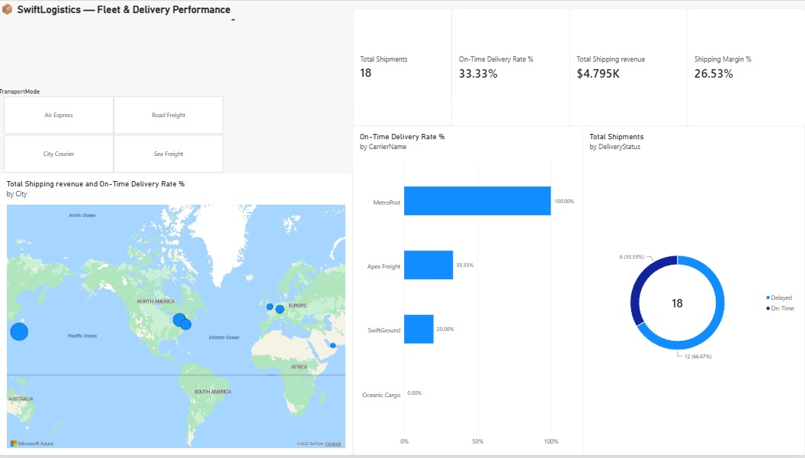

# 📦 SwiftLogistics — Global Fleet & Delivery Performance Dashboard



---

## 📌 Executive Summary

SwiftLogistics is an international freight and logistics operator moving cargo across North America, Europe, Asia, and the Middle East. Recently, operations reported an alarming spike in customer delivery complaints and unmonitored carrier SLA violations.

This project delivers an interactive **Executive Supply Chain Performance Dashboard** in Microsoft Power BI, identifying chronic delivery bottlenecks, auditing carrier compliance against contractual Service Level Agreements (SLAs), and evaluating shipping profitability.

---

## 🎯 Key Business Questions Answered

1. **SLA Compliance:** What is our company-wide On-Time Delivery Rate against the corporate benchmark of **≥ 90%**?
2. **Carrier Accountability:** Which carriers are violating their agreed turnaround times?
3. **Financial Health:** What is our net shipping margin after carrier costs are deducted?
4. **Geographic Distribution:** Which global destination hubs are receiving the highest freight volume?

---

## 🏗️ Data Architecture & Star Schema

The semantic model utilizes a normalized **Star Schema** with single-direction 1-to-Many (`1:*`) filter propagation and a dedicated Date dimension:

```
[Dim_Carriers]      [Dim_Destinations]      [Dim_Calendar]
      │                     │                      │
      ▼ (1:*)               ▼ (1:*)                ▼ (1:*)
 (Carrier SLA)       (Destination Hub)     (Shipment Timeline)
      └──────────────────────┼──────────────────────┘
                             ▼
                      [Fact_Shipments]
                     (18 Global Deliveries)
```

---

## 🧮 Advanced DAX Calculations

### 1. Calculated Columns (Row-Level Logic)

```dax
// Days taken from shipment to delivery
DeliveryDays =
DATEDIFF ( Fact_Shipments[ShipDate], Fact_Shipments[DeliveryDate], DAY )

// SLA Compliance classification
DeliveryStatus =
IF (
    Fact_Shipments[DeliveryDays] <= RELATED ( Dim_Carriers[SLA_Days] ),
    "On-Time",
    "Delayed"
)
```

### 2. On-Time Delivery Rate % (with Zero/Blank Handling)

```dax
On-Time Delivery Rate % =
IF (
    [Total Shipments] > 0,
    DIVIDE ( [On-Time Shipments] + 0, [Total Shipments], 0 ),
    0
)
```

### 3. Net Shipping Margin %

```dax
Shipping Margin % =
DIVIDE ( [Total Shipping Revenue] - [Total Carrier Cost], [Total Shipping Revenue], 0 )
```

---

## 💡 Key Business Insights Discovered

| # | Insight | Detail |
|---|---------|--------|
| 1 | **Severe SLA Failure** | SwiftLogistics operates at an overall **33.33% On-Time Delivery Rate**, failing the corporate ≥ 90% benchmark by **56.67 percentage points**. |
| 2 | **Oceanic Cargo Disaster** | Oceanic Cargo (Sea Freight) recorded a **100% failure rate** (0.00% On-Time) across all maritime consignments, averaging **3–4 days** beyond agreed SLAs. |
| 3 | **Air Express Bottlenecks** | Despite charging premium rates, Apex Freight (Air Express) achieved only a **33.33% On-Time Rate**. |
| 4 | **Star Performer** | MetroPost (City Courier) achieved **100.00% on-time performance** with zero customer delays. |
| 5 | **Profitability** | Total shipping fees generated **$4,795.00** against **$3,523.00** in carrier costs, yielding a healthy **26.53% shipping margin**. |

---

## 🚀 Strategic Recommendations for Leadership

1. **Immediate Contract Audit:** Renegotiate or terminate the SLA agreement with Oceanic Cargo due to chronic breach of sea-freight timelines.
2. **Air Freight Routing Review:** Investigate airport customs clearance delays impacting Apex Freight.
3. **Volume Allocation:** Re-route urban and short-haul packages to MetroPost to capitalize on their 100% on-time turnaround.

---

## 🛠️ Tools Used

| Tool | Purpose |
|------|---------|
| Microsoft Power BI Desktop | Dashboard development & visualization |
| DAX (Data Analysis Expressions) | Business logic & KPI calculations |
| Power Query (M ETL) | Data transformation & cleaning |
| Bing Maps Geocoding Engine | Geographic freight distribution mapping |